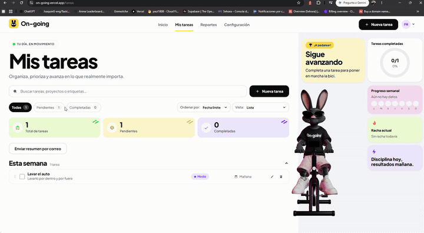
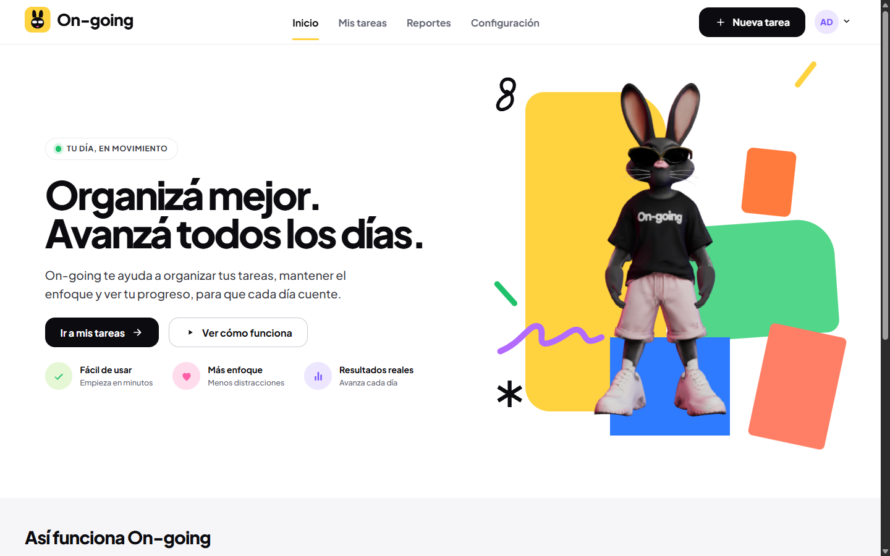
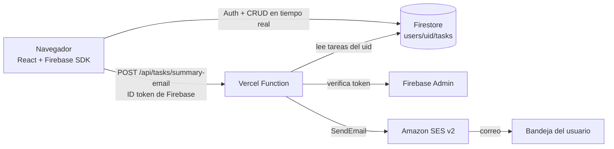

<div align="center">

# 🐰 On-going

**Organizá mejor. Avanzá todos los días.**

Gestor de tareas con progreso en tiempo real, un conejo 3D que pedalea a medida que avanzás
y resumen de tareas por correo con Amazon SES.

[](https://on-going.vercel.app)


**[🚀 Abrir la aplicación](https://on-going.vercel.app)** · **[📦 Repositorio](https://github.com/Paul-M-Corrales/ProyectoM4_PaulCorrales-)**

</div>

---

## Presentación

On-going es mi **Proyecto Integrador del Módulo 4 de Soy Henry**. Es una aplicación full stack para organizar
tareas: cada usuario inicia sesión, crea y administra sus tareas en Firestore y ve su progreso reflejado en una
mascota 3D (un conejo en bicicleta) que acelera, frena y celebra cuando se completa todo.

**Aplicación en vivo:** <https://on-going.vercel.app>  
**Repositorio:** <https://github.com/Paul-M-Corrales/ProyectoM4_PaulCorrales->

## 🎬 Demostración real — Envío de correos con AWS SES



**Qué muestra la grabación (revisada fotograma a fotograma):**

1. En *Mis tareas* se pulsa «Enviar resumen por correo» y la app responde «Solicitud aceptada»: la Vercel Function
   autenticó al usuario y **Amazon SES aceptó el envío**.
2. En el buzón de Yahoo Mail aparece un mensaje de `mailer-daemon@us-east-2.amazonses.com` con el asunto
   **«Delivery Status Notification (Failure)»**. Dentro está el contenido del resumen generado por On-going
   (total, completadas, pendientes y progreso).

> ⚠️ **Alcance de esta evidencia.** La grabación demuestra que la aplicación genera el resumen y que SES lo acepta.
> **No demuestra una entrega exitosa a la bandeja de entrada**: el mensaje recibido es un aviso de fallo de entrega.
> Hace falta una nueva grabación en la que llegue el correo original antes de afirmar la entrega.

## Vista previa

<div align="center">



</div>

## Funcionalidades

### Autenticación (Firebase Authentication)
- Inicio de sesión con **Google** y con **correo y contraseña**.
- **Registro** de cuentas nuevas y **recuperación de contraseña** por correo.
- Rutas protegidas: sin sesión solo se accede a login, registro y recuperación; con sesión se accede a la app.
- Login cinematográfico con la mascota (se omite con `prefers-reduced-motion` o si no hay WebGL).

### Tareas (Cloud Firestore)
- **CRUD completo**: crear, editar, completar/descompletar y eliminar, con actualización en **tiempo real** (`onSnapshot`).
- Cada usuario ve **solo sus tareas** (`users/{uid}/tasks/{taskId}`), protegido por reglas de seguridad.
- Búsqueda por texto (sin distinguir mayúsculas ni tildes).
- Contadores de total, pendientes y completadas, y progreso con anillo y mascota.

### Los tres extras
| Extra | Qué hace |
| --- | --- |
| **Filtros** | Todas · Pendientes · Completadas, combinables con la búsqueda y con contadores por filtro. |
| **Drag & drop** | Reordenamiento manual con `@dnd-kit` (mouse, táctil y **teclado**) y orden **persistido** en Firestore (campo `order`). |
| **Prioridad y vencimiento** | Prioridad `alta / media / baja` y fecha límite (`AAAA-MM-DD`); orden por fecha, prioridad, creación, título o personalizado. |

### Reportes
- Cifras en tiempo real sobre las mismas tareas de Mis tareas (misma suscripción a Firestore): total, completadas,
  pendientes, **vencidas** (pendientes con fecha pasada) y porcentaje completado.
- Distribución por prioridad (barras con las cifras también en texto) y próximos vencimientos.
- Sin evolución semanal: las tareas no guardan la fecha de finalización y no se inventan datos históricos.

### Configuración
- Datos de la cuenta: nombre visible, correo, método de acceso (Google o correo y contraseña) y estado de verificación.
- **Orden predeterminado de Mis tareas**: se guarda por cuenta **en este navegador** (no se sincroniza entre dispositivos)
  y se aplica al abrir Mis tareas. La vista «Tablero» aún no existe, por eso no hay preferencia de vista.

### Resumen de tareas por correo (AWS SES)
- Botón para enviarte un resumen con totales, porcentaje de avance y las tareas pendientes más urgentes.
- Solo se envía a la **dirección verificada de tu propia cuenta**; el destinatario nunca viene del navegador.
- Límite de **1 envío cada 60 s y 5 por día**.

### Mascota 3D
- Modelo GLB con 8 animaciones (`walk`, `stop`, `point`, `idle`, `ride`, `ride-idle`, `ride-mount`, `ride-celebrate`)
  con `three` y `@react-three/fiber`. Pedalea más rápido cuanto mayor es el progreso y celebra una vez al completar todo.

## Tecnologías

| Capa | Tecnología |
| --- | --- |
| Frontend | React 19, TypeScript, Vite, React Router, CSS Modules |
| 3D y animación | three.js, `@react-three/fiber`, `@react-three/drei`, `motion` |
| Interacción | `@dnd-kit` (core, sortable, utilities) |
| Autenticación y datos | Firebase Authentication y Cloud Firestore |
| Backend | Vercel Function (Node) con Firebase Admin |
| Correo | Amazon SES v2 (`@aws-sdk/client-sesv2`) |
| Calidad | Vitest, Testing Library, ESLint, `tsc`, Firebase Emulator (reglas) |
| Despliegue | Vercel |

## Arquitectura



```
src/app/                 rutas, layout y navegación
src/features/auth/       login, registro, recuperación, proveedor de sesión
src/features/tasks/      componentes, hooks, lógica (filtros, orden, grupos) y repositorio Firestore
src/features/mascot/     mascota 3D, clips y bicicleta
src/features/home|intro|sections/   inicio, intro cinematográfica y secciones
src/lib/firebase/        configuración del cliente
api/tasks/summary-email.ts   punto de entrada de la Vercel Function
server/                  handler, SES, límites de frecuencia, plantilla del correo
firestore.rules          reglas de seguridad
tests/                   Vitest + Testing Library + pruebas de reglas
scripts/                 validadores (límite de líneas, clips del GLB)
docs/                    informes por ticket y capturas
```

## Instalación local

Requisitos: **Node 20+** (probado con Node 24) y npm.

```bash
git clone https://github.com/Paul-M-Corrales/ProyectoM4_PaulCorrales-.git
cd ProyectoM4_PaulCorrales-
npm install
cp .env.example .env.local     # en PowerShell: Copy-Item .env.example .env.local
# completar .env.local con tu propio proyecto de Firebase (ver abajo)
npm run dev                    # http://localhost:5173
```

## Variables de entorno

Solo se listan **nombres**; los valores nunca van al repositorio (`.env*` está ignorado salvo `.env.example`).

**Cliente (públicas de la app web de Firebase, prefijo `VITE_`)**
`VITE_FIREBASE_API_KEY`, `VITE_FIREBASE_AUTH_DOMAIN`, `VITE_FIREBASE_PROJECT_ID`, `VITE_FIREBASE_STORAGE_BUCKET`,
`VITE_FIREBASE_MESSAGING_SENDER_ID`, `VITE_FIREBASE_APP_ID`

**Solo servidor (nunca con `VITE_`)**
`FIREBASE_PROJECT_ID`, `FIREBASE_CLIENT_EMAIL`, `FIREBASE_PRIVATE_KEY`,
`AWS_ACCESS_KEY_ID`, `AWS_SECRET_ACCESS_KEY`, `AWS_REGION`, `AWS_SES_FROM_EMAIL`

**Opcionales**
`SES_REGION` (tiene prioridad sobre `AWS_REGION`, que Vercel puede fijar en runtime), `SES_FROM_EMAIL` (alias con prioridad
sobre `AWS_SES_FROM_EMAIL`), `APP_ALLOWED_ORIGINS` (orígenes extra permitidos, separados por coma).

## Scripts disponibles

| Comando | Descripción |
| --- | --- |
| `npm run dev` | Servidor de desarrollo (sirve también el endpoint de correo) |
| `npm run build` | Chequeo de tipos + build de producción |
| `npm run preview` | Previsualiza el build |
| `npm run lint` | ESLint |
| `npm run typecheck` | TypeScript sin emitir |
| `npm test` | Tests con Vitest |
| `npm run test:rules` | Reglas de Firestore contra el emulador (requiere Java) |
| `npm run check:lines` | Falla si algún archivo de código supera **150 líneas** |
| `npm run check:glb` | Verifica los 8 clips del modelo 3D |
| `npm run validate` | Lint + typecheck + tests + líneas + GLB + build |

## Tests y validaciones

- **43 archivos y 267 tests** con Vitest (UI, hooks, repositorio, filtros, orden, endpoint de correo, aislamiento entre usuarios).
- Las **reglas de Firestore** se prueban aparte con el emulador (`npm run test:rules`, 10 tests en 2 archivos).
- Los tests usan dobles de Firebase y AWS: **no envían correos reales**.
- Regla de calidad del proyecto: ningún archivo de código supera 150 líneas, validado automáticamente.

### Integración continua (GitHub Actions)

El workflow [`.github/workflows/ci.yml`](.github/workflows/ci.yml) se ejecuta en cada `push` y `pull_request` sobre `main`,
con Node 24 e instalación reproducible (`npm ci`). Tiene dos jobs:

| Job | Comandos |
| --- | --- |
| **Lint, tipos, tests y build** | `npm run lint` · `typecheck` · `test` · `check:lines` · `check:glb` · `build` |
| **Reglas de Firestore (emulador)** | `npm run test:rules` con Java 21 y el emulador, usando el proyecto demo `demo-ongoing` |

La CI **solo valida**: no usa credenciales de AWS ni de Firebase, el `GITHUB_TOKEN` tiene permiso de solo lectura
y no despliega nada (el despliegue sigue en Vercel).

## Resumen por correo con AWS SES

1. El navegador llama a `POST /api/tasks/summary-email` con el ID token de Firebase.
2. La **Vercel Function** verifica la identidad con Firebase Admin; el UID y el destinatario salen del token verificado
   (cuenta con correo verificado), nunca del cuerpo de la solicitud.
3. Reserva el envío con límite de frecuencia persistente en Firestore.
4. Lee **solo las tareas de ese usuario** desde Firestore y construye el resumen.
5. Envía el correo con **Amazon SES v2**. Las respuestas al navegador son genéricas.

> ⚠️ **SES en Sandbox.** La cuenta de SES permanece en *Sandbox*: solo puede enviar desde y hacia direcciones
> **verificadas**, y no está habilitado para cualquier destinatario. Para eso hay que solicitar a AWS el acceso a
> producción. Con una cuenta verificada SES aceptó el envío (ver la demostración), pero la entrega a la bandeja de
> entrada no quedó demostrada: que SES acepte un mensaje no garantiza que el proveedor del destinatario lo entregue.

Detalles operativos en [`docs/ONGOING-M4-007-email-setup.md`](docs/ONGOING-M4-007-email-setup.md).

## Seguridad

- Sin credenciales en el repositorio; las claves de AWS y de Firebase Admin viven solo en variables de entorno del servidor.
- **Reglas de Firestore** por usuario: lectura y escritura solo del propio `users/{uid}/tasks`, con validación de forma y
  tipos; todo lo demás está denegado.
- El endpoint exige método `POST`, cabecera propia, origen permitido y un token de Firebase válido.
- Política IAM de mínimo privilegio para el usuario de SES (solo `ses:SendEmail` sobre la identidad remitente).
- Los logs del servidor registran únicamente metadatos saneados del error: no credenciales, tokens, ARN ni correos.

## Despliegue

La app se publica en **Vercel** (proyecto `on-going`); cada push a `main` genera un deployment de producción.
`vercel.json` incluye un *rewrite* para que las rutas de la SPA funcionen al recargar. Las variables del servidor se
configuran en Vercel → Settings → Environment Variables. Las reglas de Firestore se publican aparte
(`firebase deploy --only firestore:rules`).

## Autor

**Paul Matías Corrales** — Proyecto Integrador, Módulo 4, [Soy Henry](https://www.soyhenry.com/).

- GitHub: [@Paul-M-Corrales](https://github.com/Paul-M-Corrales)
- Repositorio: <https://github.com/Paul-M-Corrales/ProyectoM4_PaulCorrales->
- Aplicación: <https://on-going.vercel.app>
